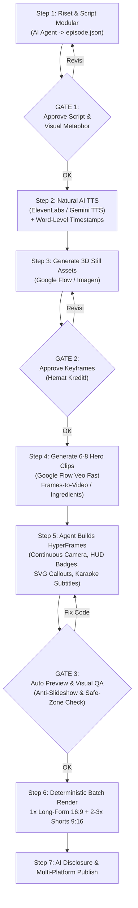

# Product Plan & Full-AI Production Architecture: Channel "Sains 60 Detik" (v2.0)

Dokumen ini adalah pembaruan final dari *Product Plan*, *Workflow*, dan *Requirements* yang disesuaikan dengan keputusanmu:
1. **Niche:** General *Proof & Myth* (lintas topik: teknologi, sains sehari-hari, kesehatan, makanan, sejarah, fisika benda sekitar).
2. **Voiceover:** AI TTS Bahasa Indonesia senatural mungkin (*conversational explainer*).
3. **Editing:** **100% Full-AI / Code-Driven Video Pipeline** (tanpa CapCut/Premiere manual), mengadopsi ekosistem skill & repo open-source (`hyperframes`, `onetake`, `gbro-collage-broll`, `bang-story`).
4. **Tier Visual AI:** **Google AI Pro** (kuota ~1.000 AI credits/bulan + 50 daily credits, *non-rollover*).

---

## 1. Evaluasi 4 Referensi GitHub & Perannya di Pipeline Kita

Berdasarkan analisis terhadap 4 repositori yang kamu referensikan, berikut pemetaan peran masing-masing agar saling melengkapi (bukan tumpang tindih) dan **aman untuk monetisasi komersial**:

| Referensi | Kekuatan Utama | Peran di Pipeline Kita | Catatan Penting / Lisensi |
| :--- | :--- | :--- | :--- |
| **[heygen-com/hyperframes](https://github.com/heygen-com/hyperframes)** | Framework video berbasis HTML/CSS/GSAP → deterministic MP4 (FFmpeg). Punya *component registry* & skill CLI (`npx skills add heygen-com/hyperframes`). | **CORE RENDERING & EDITING ENGINE.** Menggantikan CapCut/Premiere sepenuhnya: menggabungkan klip/gambar Google Flow + merender HUD *Elevenbyte* (*chapter title*, *pill badges*, *SVG callout pointer*, *karaoke subtitle*) sekaligus **auto-layout 16:9 & 9:16**. | Open-source & *commercial-friendly*. |
| **[feitangyuan/onetake](https://github.com/feitangyuan/onetake)** | Menghilangkan *slideshow problem* lewat *continuous camera*, fisika *spring-damper*, *visual carry*, dan *continuity audit* (`probe.py`). | **ADOPSI PRINSIP DESAIN & QA.** Kita tiru filosofi *continuous camera*, *spring easing*, dan *visual carry* saat menulis animasi GSAP di HyperFrames agar transisi mulus seperti referensi *Elevenbyte*. | **⚠️ PERINGATAN LISENSI:** Menggunakan **PolyForm Noncommercial 1.0.0**. Karena YouTube & FB Pro bersifat komersial (monetisasi), **jangan pakai kode `onetake` secara langsung**; cukup adopsi polanya di atas HyperFrames. |
| **[pyang5166/gbro-collage-broll](https://github.com/pyang5166/gbro-collage-broll)** | Pola **Three-Gate Approval** (Metaphor → Still Frame → Video Animation) untuk mencegah pemborosan kredit + gaya B-roll *halftone paper-collage*. | **PROSES KONTROL BIAYA (THREE-GATE).** Wajib diterapkan sebelum generate di Google Flow agar kredit Pro tidak terbuang. Gaya *paper-collage*-nya juga bisa dipakai sebagai variasi B-roll khusus topik sejarah/mitos abstrak. | Sangat cocok untuk memproteksi limit 1.000 kredit/bulan Google AI Pro. |
| **[bangtutorial/bang-story](https://github.com/bangtutorial/bang-story)** | Pipeline otomatis (MIT License): Ide → Script per adegan → Asset Sheet → Auto TTS (Gemini TTS / ElevenLabs) + sinkronisasi caption per adegan (16:9 & 9:16). | **POLA ORKESTRASI DATA (JSON PIPELINE).** Kita adopsi alur *Script JSON → Auto TTS → Word-Level Timestamp → Scene Assembly* sebagai *input data* yang dibaca langsung oleh HyperFrames. | Lisensi MIT (aman diadaptasi/dipakai untuk komersial). |

> [!IMPORTANT]
> **Kesimpulan Arsitektur:**
> **Google Flow** memproduksi *raw 3D visual & hero animation* (bersih tanpa teks) → **AI TTS + Forced Alignment** memproduksi audio & `words.json` → **HyperFrames (dikendalikan AI Agent)** merakit seluruh video, animasi kamera *continuous*, *pill badges*, garis *callout*, dan *karaoke subtitles* menjadi **1 MP4 Long-Form (16:9)** + **2–3 MP4 Shorts/Reels (9:16)** dari satu basis kode yang sama.

---

## 2. Strategi Hemat Kredit Google AI Pro (1.000/Bulan + 50/Hari)

Pada paket **Google AI Pro**, kuota kredit terbatas (~1.000 kredit bulanan + 50 kredit harian yang tidak terakumulasi). Jika seluruh video 4 menit (40 klip) di-render dengan Veo video, kuota bulanan akan habis hanya dalam 1–2 episode.

Karena kita memakai **HyperFrames**, kita punya keunggulan besar: **animasi kamera, zoom, pan, cutaway diagram, partikel panas, viewfinder mikroskop, dan tipografi bisa dirender 100% gratis lewat kode!**

### Aturan Alokasi Visual "30 / 50 / 20" per Episode (4 Menit)
- **30% — Veo Hero Video Clips (Google Flow):** Hanya untuk momen "wow" yang butuh simulasi fisika nyata (cairan mengalir, percikan api/panas, mekanisme 3D bergerak). Target **6–8 klip/episode** menggunakan **Veo Fast** (~20 kredit/klip) → **~120–160 kredit/episode**.
- **50% — High-Res 3D Still Assets (Google Flow / Imagen) + HyperFrames Motion:** Generate gambar 3D makro & *microscopic cutaway* bersih (jauh lebih hemat kredit), lalu animasikan di HyperFrames dengan *2.5D parallax*, *smooth dolly zoom*, *specular light sweep*, dan *particle overlay* (mirip persis dengan gaya *Elevenbyte*!).
- **20% — Pure Procedural Motion Graphics (HyperFrames):** Grafik perbandingan angka (mis. *1% kontak logam vs 99% udara*), diagram mitos vs fakta, meteran suhu, dan *title transitions* — **0 kredit Google Flow**.

**Hasil:** Dengan 1.000 kredit/bulan + pemanfaatan 50 kredit harian, kamu bisa memproduksi **6–10 episode Long-Form/bulan** (= **6–10 YouTube Long** + **18–30 Shorts/Reels**!).

---

## 3. Product Plan: Channel "Sains 60 Detik" & Dual-Format Reuse

### 3.1 Pilar Topik General (Agar Konsisten Meski Lintas Bidang)
Agar channel tidak terasa "campur aduk tanpa identitas" meski topiknya umum, kunci seluruh episode dalam **1 Formula Visual & Narasi**:
- **Visual Identity:** Semua topik (baik HP, kopi, tubuh manusia, pesawat, maupun sejarah) selalu divisualisasikan dengan **estetika 3D Clean Studio + Dark Navy Cutaway (`#0F172A`)**.
- **Rotasi 4 Pilar Topik:**
  1. *Tech & Gadget Myths* (baterai, sinyal, pendingin, AI).
  2. *Body & Health Myths* (kopi, tidur, olahraga, makanan).
  3. *Everyday Physics & Objects* (pesawat, microwave, AC, kendaraan).
  4. *History & Viral Claims* (mitos populer internet yang dibuktikan dengan data/visualisasi).

### 3.2 Modular "1 Master → 3 Clips" Architecture (Single Source of Truth)
Setiap episode Long-Form (3–5 menit) disimpan sebagai 1 folder proyek dengan file `episode.json`:

```text
episode.json (Master 4 Menit)
├── intro        (0:00–0:20)  → Hanya dirender di build 16:9
├── module_1     (0:20–1:30)  → Mini-Hook + Bukti + Kesimpulan ──► Auto-render Short #1 (9:16)
├── module_2     (1:30–2:40)  → Mini-Hook + Bukti + Kesimpulan ──► Auto-render Short #2 (9:16)
├── module_3     (2:40–3:45)  → Mini-Hook + Bukti + Kesimpulan ──► Auto-render Short #3 (9:16)
└── outro        (3:45–4:05)  → Hanya dirender di build 16:9
```

Karena HyperFrames berbasis HTML/CSS:
- `render --format 16:9` merender seluruh `episode.json` dengan layout lanskap (HUD di sisi kiri/kanan objek).
- `render --format 9:16 --module module_1` otomatis memotong `module_1`, mengaktifkan CSS *safe-zone* vertikal (20% atas *Chapter Header*, 55% tengah visual + *callout*, 25% bawah *Karaoke Subtitle*), dan mengekspor MP4 1080×1920 siap upload ke **YouTube Shorts** & **Facebook Pro Reels**.

---

## 4. End-to-End Full-AI Production Workflow



### Detail Tiap Tahap:
1. **Step 1 — Script Modular & Fact-Checking (`episode.json`):** AI Agent menyusun naskah 3 modul (130–150 kata/menit), daftar angka/fakta terverifikasi, *visual beats* setiap 2–4 detik, serta daftar aset yang dibagi menjadi `veo_hero` (30%), `still_3d` (50%), dan `procedural` (20%).
   - **Gate 1 (Manusia):** Kamu cukup baca script + konsep visual 2 menit. Jika oke, lanjut.
2. **Step 2 — Natural AI TTS & Word-Level Alignment:**
   - **Opsi Utama (Paling Natural + Instant Word Timestamps):** **ElevenLabs API** (`eleven_multilingual_v2` / `eleven_flash_v2_5` dengan endpoint `with-timestamps`) → langsung dapat file `.mp3` + JSON waktu tiap kata untuk *karaoke highlight* kuning persis seperti referensi!
   - **Opsi Hemat (Ekonomi/Google Ecosystem):** **Gemini TTS** dengan instruksi gaya (*"intonasi santai, penuh rasa ingin tahu, seperti narator edukasi Indonesia"*) + jalankan **`faster-whisper`** lokal (gratis) untuk menghasilkan `words.json`.
   - Otomatis lakukan *silence trimming* (FFmpeg) agar ritme ketat tanpa jeda kosong.
3. **Step 3 — 3D Keyframes / Ingredients (Google Flow):** Generate gambar 3D bersih (*text-free, centered composition*) sebagai aset visual utama sekaligus bahan *Ingredients* untuk Veo.
   - **Gate 2 (Manusia):** Cek konsistensi gaya & komposisi gambar sebelum memanggil Veo.
4. **Step 4 — Hero Video Generation (Google Flow Veo):** Hanya 6–8 *hero shot* yang dianimasikan dengan Veo (*Frames-to-Video* untuk transisi makro → cutaway, atau *Ingredients-to-Video*).
5. **Step 5 — Full-AI Assembly di HyperFrames:**
   - AI Agent (seperti Antigravity / Claude Code dengan skill `hyperframes`) membaca `episode.json`, `audio.mp3`, `words.json`, dan folder aset Google Flow.
   - AI Agent merakit komponen reusable:
     - `<ChapterHeader />` (2 baris kiri atas, baris kedua aksen merah/kuning)
     - `<PillBadge />` & `<CalloutPointer />` (SVG animasi garis + titik jangkar)
     - `<MicroscopeFrame />` (sudut L-bracket + zoom cutaway)
     - `<KaraokeSubtitle />` (box gelap transparan + kotak kuning aktif yang mengikuti `words.json` per milidetik)
     - Transisi kamera *continuous* (terinspirasi prinsip *visual carry* & *spring physics* dari Onetake).
   - **Gate 3 (Preview & QA):** Buka preview lokal HyperFrames di browser (atau biarkan agent melakukan *frame-spot check* di titik-titik kunci untuk memastikan tidak ada teks bertabrakan/keluar safe-zone).
6. **Step 6 — Batch Render (Deterministic MP4):** 1 perintah CLI menghasilkan 1 file 16:9 (3–5 menit) + 2–3 file 9:16 (1–2,5 menit) lengkap dengan BGM *royalty-free* (-24 dB) & SFX (*whoosh, pop, click*).
7. **Step 7 — Publishing:** Upload ke YouTube (aktifkan label *Altered/Synthetic Content* untuk klip AI realistis) & *native upload* bersih tanpa watermark ke Facebook Pro Reels.

---

## 5. System & Technical Requirements

### 5.1 Software & Runtime Environment (Lokal di Mac)
- **Node.js (v20+ LTS)** & **npm/pnpm** — untuk menjalankan HyperFrames CLI & rendering engine.
- **FFmpeg** (`brew install ffmpeg`) — untuk pemotongan jeda audio, mixing BGM/SFX, dan encoding MP4 final.
- **Python 3.10+** + **`faster-whisper`** *(opsional jika pakai Gemini TTS)* — untuk ekstraksi *word-level timestamps* lokal secara gratis.
- **HyperFrames Skill & CLI** — dipasang di workspace `/Users/960339/AI Vid Gen` (`npx skills add heygen-com/hyperframes`).

### 5.2 Langganan & API Stack

| Layanan | Status / Estimasi Biaya | Fungsi |
| :--- | :--- | :--- |
| **Google AI Pro (Google Flow)** | **Sudah ada** (\$19.99/bln) | 1.000 kredit/bln + 50/hari untuk aset 3D & 6–8 klip Veo Fast/episode. |
| **ElevenLabs** *(Pilihan #1 VO)* | Starter ~\$5/bln (30k karakter ≈ 8–10 episode) | AI TTS Bahasa Indonesia paling natural + *native word timestamps*. |
| **Gemini API (TTS)** *(Alternatif VO)* | Pay-as-you-go sangat murah | Alternatif TTS + `faster-whisper` lokal untuk *word timestamps*. |
| **HyperFrames + FFmpeg** | **Gratis (Open Source)** | Full-AI programmatic video editor, HUD, *karaoke subtitle*, dual-format render. |
| **SFX & BGM Pack** | **Gratis** (YouTube Audio Library / Pixabay) | Folder lokal berisi 15–20 SFX standar (*whoosh, pop, tick, spark, hum*) + 5 BGM *curiosity/tech* agar AI Agent tinggal memanggilnya lewat kode. |

### 5.3 Struktur Proyek di Workspace (`/Users/960339/AI Vid Gen`)
```text
/Users/960339/AI Vid Gen/
├── engine/                       # HyperFrames project & reusable components
│   ├── components/               # ChapterHeader, PillBadge, CalloutPointer, KaraokeSubtitle, MicroscopeFrame
│   ├── styles/                   # Brand Kit CSS tokens (#0F172A, #FACC15, #EF4444, #2563EB)
│   └── templates/                # Layout 16:9 (Long) & 9:16 (Short/Reel Safe-Zone)
├── library/
│   ├── sfx/                      # whoosh.wav, pop.wav, click.wav, heat.wav
│   └── bgm/                      # curiosity_loop_1.mp3, tech_ambient_1.mp3
├── scripts/
│   ├── tts_generate.py           # Generate VO + words.json (ElevenLabs / Gemini+Whisper)
│   └── render_episode.sh         # Batch render 16:9 Master + 9:16 Modules
└── episodes/
    └── ep01_contoh_topik/
        ├── episode.json          # Single Source of Truth (script, beats, badges, prompts)
        ├── audio/                # vo_master.mp3 + words.json
        ├── assets/               # Raw stills & Veo clips dari Google Flow
        └── output/               # ep01_long_16x9.mp4, ep01_short1_9x16.mp4, dst.
```

---

## 6. Roadmap Eksekusi Cepat (Dari Nol ke Episode #1)

| Tahap | Fokus | Output Konkret |
| :--- | :--- | :--- |
| **Fase 1: Setup Engine (Hari 1–2)** | Install HyperFrames, FFmpeg, dan bangun 5 komponen UI *Elevenbyte-style* + sistem dual-format 16:9 & 9:16. | Template engine siap pakai + 1 video dummy 15 detik untuk verifikasi kualitas render & karaoke subtitle. |
| **Fase 2: Audio Pipeline (Hari 3)** | Setup script `tts_generate.py` (ElevenLabs atau Gemini TTS + Whisper) + kumpulkan 15 SFX & 3 BGM dasar. | Test 1 paragraf VO Indonesia natural + `words.json` sinkron 100%. |
| **Fase 3: Pilot Episode #1 (Hari 4–6)** | Jalankan *Three-Gate Workflow* untuk 1 episode penuh (4 menit) → generate 6–8 klip Veo + 15 still 3D di Google Flow → render 1 Long + 3 Shorts/Reels. | 4 video siap upload (1 YouTube Long, 3 YouTube Shorts, 3 Facebook Pro Reels). |
| **Fase 4: Scale & Optimasi (Minggu 2–4)** | Sempurnakan *prompt bank* Google Flow & *spring animations* berdasarkan retensi penonton Episode #1–#2. | Ritme rutin 2 Long-Form + 6 Shorts/Reels per minggu dengan sisa kredit Google AI Pro aman. |
